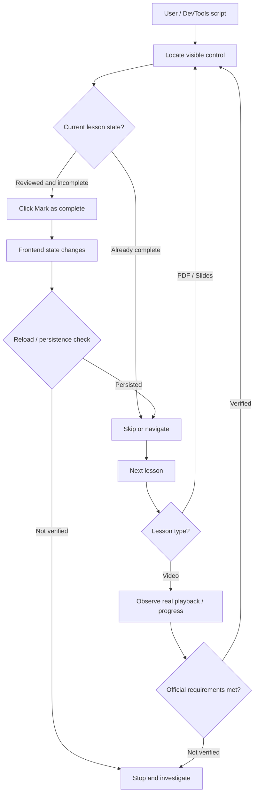
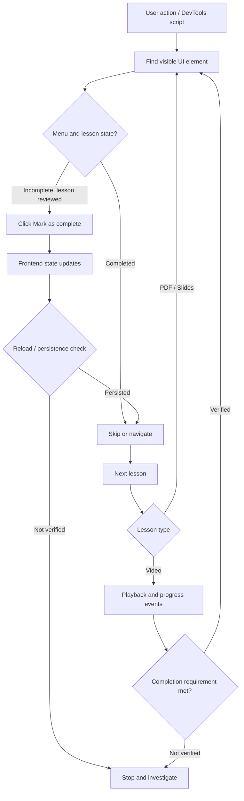

# Browser UI Automation & Debugging Lab

[](#english)


**Languages / Ngôn ngữ:** [English ↓](#english) · [Tiếng Việt ↓](#tiếng-việt)  
**Detailed case log / Nhật ký phân tích:** [docs/troubleshooting.md](docs/troubleshooting.md)

The same case study is documented **in full in English first, then in Vietnamese**.  
Cùng một case study được trình bày **đầy đủ bằng tiếng Anh ở trên và tiếng Việt ở dưới**.

---

## English

> **Case study:** Investigating and prototyping user-interface automation in a Jetking/Learnyst learning portal with Firefox DevTools and JavaScript.  
> **Method:** *Problem → Investigation → Hypotheses → Experiment → Evidence → Root cause → Solution → Limitations.*

### 1. Project overview

A course contains many lessons with **Mark as complete** and **Next lesson** controls. This project began with a practical engineering question: *Can repeated UI operations be reduced without losing track of what the application really did?*

Instead of immediately building a bulk-click bot, the investigation examined **HTML/DOM, CSS selectors, menu state, Shadow DOM, asynchronous navigation, Console logs, CORS warnings, and PDF/slide lessons versus video-player behavior**.

**Scope:** This is an independent learning case study, **not** an official Jetking/Learnyst application. Examples are intended for content the user may access and has actually studied. They are not designed to simulate watch time, bypass assessments, or misrepresent course completion.

#### Observed results

| Investigation | Evidence | Justified conclusion |
|---|---|---|
| Initial generic selector | `Không tìm thấy nút hoàn thành` (completion button not found) | The assumptions about element visibility/state or selection were insufficient; this does **not** establish that the platform blocked the action. |
| DOM and Shadow DOM scan | `shadowRoots: 5`, `frames: 0`, `matches: 2` | `Next lesson` and `Mark as complete` were found in the main document **at that moment**. |
| One controlled JS click | User confirmed that the lesson's visible state changed | The UI received the click and responded. |
| Ancestor HTML inspection | `button.lp-menu-item`; `button.lp-icon[aria-label="Settings"]` | The actionable button and menu opener were identified. |
| Three-iteration proof of concept | Console: `Đã đánh dấu thêm 2 bài` (marked 2 additional lessons) | The script reported two UI-level updates; **persistence and eligibility were not established**. |
| Navigation to a video lesson | Player lifecycle and initial progress logs | Video playback has its own event flow; loading does not equal having watched the lesson. |

**Key distinction:** `click()` succeeded ≠ learning completed ≠ server state persisted ≠ platform completion requirements met.

### 2. Skills demonstrated

| Investigation task | Technical concept | Question to ask |
|---|---|---|
| Inspect HTML with DevTools | **DOM inspection** | Which DOM tree actually contains the visible element? |
| Identify buttons using CSS selectors | **DOM querying** | Is this selector accurate, unique, and resilient? |
| Detect five Shadow Roots | **Shadow DOM** | Is the element in an open or closed shadow root? |
| Click buttons with JavaScript | **Browser automation / DOM events** | Which element receives the click, and what changes? |
| Coordinate actions with `async/await` | **Asynchronous programming** | Are we waiting for rendering, state changes, or route transitions? |
| Re-check state after clicking | **State validation** | Does the status survive a page reload? |
| Analyze a CORS warning | **Web security / Same-Origin Policy** | Is this warning related to the failed action, or just concurrent noise? |
| Compare PDF/slides and video | **Event-driven architecture** | Does the video have additional playback/progress requirements? |

### 3. Interaction model (a hypothesis, not a verified architecture)



The server-side persistence path and the video's completion rules were **not directly observed**; the diagram makes those uncertainty boundaries explicit.

### 4. Debugging mindset: measure before changing anything

| Step | What to do | Example from this case |
|---|---|---|
| **Problem** | State a measurable symptom | Initial script stopped at zero marked lessons. |
| **Hypotheses** | Generate competing explanations | Menu closed, already complete, wrong selector, Shadow DOM. |
| **Minimal experiment** | Prefer a small **read-only** test | Inspect `aria-expanded`, element text, Shadow Roots. |
| **Evidence** | Record the actual sanitized output | `matches: 2`, `frames: 0`. |
| **Interpretation** | Eliminate or retain hypotheses | The target labels were in the main DOM on that run. |
| **Solution** | Make the smallest change | Click the parent `button`, not an arbitrary `span`. |
| **Verification** | Validate behavior and persistence | Menu changes; then reload to check it remains changed. |
| **Limitations** | State what the test did not prove | Video `loaded completed` did not prove the video was watched. |

Use three evidence labels consistently: **[OBSERVED]** (direct output), **[INFERRED]** (plausible explanation), and **[UNVERIFIED]** (not yet established).

### 5. Reproducing the safe investigation

#### 5.1 Open DevTools

1. Open a lesson in your own authorized account.
2. Press `F12` and select **Console** in Firefox or Chrome.
3. Open the lesson's Settings menu and inspect whether it says `Mark as complete` or `Mark as incomplete`.
4. Read any Console snippet before running it; never paste unknown code.

#### 5.2 Read-only UI inspection

```js
(() => {
  const labels = ["Mark as complete", "Mark as incomplete", "Next lesson"];
  const items = [...document.querySelectorAll("button.lp-menu-item")].map(el => ({
    label: el.textContent.trim(),
    visible: el.getClientRects().length > 0,
    disabled: el.disabled
  }));
  console.table(items.filter(item => labels.includes(item.label)));
  const menu = document.querySelector('button.lp-icon[aria-label="Settings"]');
  console.log("Menu expanded:", menu?.getAttribute("aria-expanded"));
})();
```

#### 5.3 One controlled click on a lesson already studied

> Run only when you have completed the lesson's real requirements and the open menu shows `Mark as complete`.

```js
(() => {
  const target = [...document.querySelectorAll("button.lp-menu-item")]
    .find(el => el.textContent.trim() === "Mark as complete"
      && el.getClientRects().length > 0);
  if (!target) return console.log("No visible Mark as complete control.");
  target.click();
  console.log("Click sent. Inspect UI, then reload to check persistence.");
})();
```

This is an **exploratory UI test**, not a verified general-purpose automation product. Avoid using it to mark content that has not been studied or video requirements that have not been fulfilled.

### 6. Repository layout

```text
browser-ui-automation-lab/
├── README.md                  # Project, concepts, responsible reproduction
└── docs/
    └── troubleshooting.md    # Investigation timeline and technical analysis
```

See the bilingual **[Troubleshooting & Investigation Log](docs/troubleshooting.md)** for the chronological experiments, code, diagnostic conclusions, and open questions.

### 7. Security and responsible use

- Never commit cookies, bearer tokens, `Authorization` headers, session identifiers, raw HAR captures, or URLs containing a `tk` query parameter. Sanitize screenshots and logs.
- Do **not** disable CORS or weaken the browser's Same-Origin Policy.
- Use permitted UI controls; do not call private APIs to alter course progress or forge video playback events.
- Keep experiments bounded, interruptible, and validated after reload.
- Treat `Mark as incomplete` as **visible UI state**, not proof of server-side acceptance.
- Follow the learning platform's terms and actual lesson/assessment requirements.

### 8. Limitations and next experiments

| Current limitation | Why it matters | Responsible improvement |
|---|---|---|
| English-label-based selectors | Text/locale changes break matching | Prefer semantic roles and verify DOM structure. |
| Hard-coded `sleep()` delays | SPA and video rendering times vary | Wait for conditions with bounded polling or `MutationObserver`. |
| URL-change-based navigation | SPA may update without URL changes | Verify lesson ID, heading, or visible content. |
| UI state might not persist | Server write may fail or be delayed | Reload and inspect the platform's official status. |
| Video has extra event flow | Media loaded ≠ watched or eligible | Let genuine playback finish; verify official completion. |
| Console execution may end on reload | Automation can stop mid-run | Use carefully controlled opt-in tooling only for legitimate tasks. |

### 9. Conclusion

The key output is **an evidence-driven debugging method**, not a faster click bot. A failure may occur at element discovery, click targeting, rendering, frontend state, persistence, or learning requirements—and each requires a different test.

**Tech stack:** vanilla JavaScript, Firefox DevTools, DOM API, CSS selectors, Shadow DOM, `async/await`, browser security concepts.  
**Disclaimer:** Independent educational study; not affiliated with or endorsed by Jetking/Learnyst.

---

## Tiếng Việt

> **Case study:** Tìm hiểu và thử nghiệm tự động hóa thao tác trên giao diện học tập Jetking/Learnyst bằng Firefox DevTools và JavaScript.  
> **Trọng tâm:** *Problem → Investigation → Hypothesis → Experiment → Evidence → Root Cause → Solution → Limitations*.


### 1. Project overview

Trong một khóa học trực tuyến gồm nhiều bài, người học cần thao tác **Mark as complete** và **Next lesson**. Dự án này xuất phát từ câu hỏi thực tế: *Có thể giảm thao tác lặp lại bằng JavaScript mà vẫn hiểu và kiểm chứng trạng thái của ứng dụng không?*

Thay vì viết ngay một script click hàng loạt, mình lần lượt khảo sát **HTML/DOM, CSS selector, trạng thái menu, Shadow DOM, lời gọi bất đồng bộ, Console logs và sự khác nhau giữa tài liệu PDF/Slides với video player**.

**Phạm vi:** Đây là case study độc lập phục vụ học tập; không phải công cụ chính thức của Jetking/Learnyst. Các ví dụ chỉ dùng trên tài khoản và nội dung bạn có quyền truy cập, để hỗ trợ thao tác với **những bài đã thực sự học**. Không giả mạo thời lượng xem video, không vượt qua quiz hoặc tiêu chí hoàn thành của nền tảng.

#### Kết quả đã quan sát

| Mốc thử nghiệm | Bằng chứng | Kết luận đúng mức |
|---|---|---|
| Tìm nút bằng selector tổng quát | `Không tìm thấy nút hoàn thành` | Selector/trạng thái trang ban đầu chưa phù hợp; **không** chứng minh tính năng bị chặn |
| Quét DOM và Shadow DOM | `shadowRoots: 5`, `frames: 0`, `matches: 2` | Tìm được `Next lesson` và `Mark as complete` trong DOM chính ở thời điểm quét |
| Click một bài bằng JS | Người dùng xác nhận bài đổi trạng thái | Gửi sự kiện click thành công và UI phản hồi |
| Kiểm tra cấu trúc HTML | `button.lp-menu-item`, `button.lp-icon[aria-label="Settings"]` | Xác định selector cụ thể hơn cho menu |
| Script thử nghiệm giới hạn 3 bài | Log: `Đã đánh dấu thêm 2 bài` | Script báo đã click và xác minh **trạng thái giao diện** cho 2 bài; chưa phải xác nhận server lưu vĩnh viễn |
| Điều hướng tới bài video | Console cho thấy video player khởi tạo, tải nội dung | Video có vòng đời sự kiện riêng; chưa đủ bằng chứng rằng điều kiện xem video đã đạt |

> **Điều quan trọng nhất:** `click()` thành công ≠ nội dung đã được học ≠ backend đã lưu trạng thái ≠ nền tảng xác nhận đủ điều kiện hoàn thành.

### 2. Kiến thức thực hành

| Nội dung đã làm | Kiến thức thể hiện | Câu hỏi cần tự đặt ra |
|---|---|---|
| Phân tích HTML bằng DevTools | **DOM inspection** | Phần tử nhìn thấy trên UI có thật trong DOM nào? |
| Tìm nút bằng CSS selector | **DOM querying** | Selector có đúng, duy nhất, và ổn định không? |
| Phát hiện 5 Shadow Roots | **Shadow DOM** | Phần tử có nằm trong shadow root? `open` hay `closed`? |
| Click nút bằng JavaScript | **Browser automation / DOM events** | Sự kiện click được gửi đến element nào? UI có phản hồi không? |
| Dùng `async/await` | **Asynchronous programming** | Có cần đợi menu render, trạng thái cập nhật hoặc route chuyển không? |
| Kiểm tra sau khi click | **State validation** | UI, sau reload, và dữ liệu lưu trữ có thống nhất không? |
| Phân tích CORS Warning | **Web security / Same-Origin Policy** | Cảnh báo thuộc endpoint nào? Có thực sự khiến thao tác thất bại? |
| Debug PDF/Slides và Video | **Event-driven architecture** | Video cần thêm playback/progress/eligibility events không? |

### 3. Kiến trúc tương tác (mô hình tư duy)



Đây là **mô hình phân tích**, không phải sơ đồ reverse-engineer đã được xác nhận hoàn toàn. Nhánh lưu trạng thái phía server và điều kiện hoàn thành video chưa được quan sát trực tiếp.

### 4. Debugging mindset: đừng đoán khi có thể kiểm chứng

Mình sử dụng một vòng lặp điều tra nhỏ cho từng lỗi:

| Bước | Việc cần làm | Ví dụ trong project |
|---|---|---|
| **1. Problem** | Mô tả hiện tượng đo được | Script dừng ở 0 bài |
| **2. Hypotheses** | Đưa ra **nhiều** giả thuyết | Menu chưa mở; bài đã complete; selector sai; Shadow DOM |
| **3. Minimal experiment** | Viết thử nghiệm nhỏ, ưu tiên **chỉ đọc** | Đếm text match; xem `aria-expanded`; quét Shadow Roots |
| **4. Evidence** | Ghi output nguyên văn, bỏ token | `matches: 2`, `frames: 0` |
| **5. Interpretation** | Loại giả thuyết nào, giữ giả thuyết nào | Nút nằm ở DOM chính, không cần truy cập iframe |
| **6. Solution** | Thay đổi tối thiểu, thử trên 1 bài | Click phần tử cha là `button` |
| **7. Verification** | Kiểm tra cả hành vi và trạng thái sau reload | Menu đổi sang `Mark as incomplete` rồi refresh |
| **8. Limitations** | Không phóng đại điều chưa chứng minh | Video log `loaded completed` **không** nghĩa là đã xem hết |

**Mẹo:** Phân biệt rõ ba nhãn trong ghi chú kỹ thuật: **Observed** (đã thấy), **Inferred** (suy luận hợp lý) và **Unknown** (chưa xác minh).

### 5. Các bước tái hiện nghiên cứu an toàn

#### 5.1. Mở DevTools

1. Mở trang bài học khi đã đăng nhập bằng tài khoản của mình.
2. Nhấn `F12` → **Console** (Firefox/Chrome).
3. Mở menu Settings của bài học. Kiểm tra bài đang hiện `Mark as complete` hay `Mark as incomplete`.
4. Chỉ dán mã mình đã hiểu; không copy các lệnh Console không rõ nguồn gốc.

#### 5.2. Kiểm tra DOM mà **không thay đổi trang**

```js
(() => {
  const labels = ["Mark as complete", "Mark as incomplete", "Next lesson"];
  const items = [...document.querySelectorAll("button.lp-menu-item")].map(el => ({
    label: el.textContent.trim(),
    visible: el.getClientRects().length > 0,
    disabled: el.disabled
  }));
  console.table(items.filter(item => labels.includes(item.label)));
  const menu = document.querySelector('button.lp-icon[aria-label="Settings"]');
  console.log("Menu expanded:", menu?.getAttribute("aria-expanded"));
})();
```

#### 5.3. Ví dụ thử nghiệm click **một** bài đã học

> Chỉ chạy khi bạn đã kiểm tra bài học và đang muốn ghi nhận hoàn thành; trước khi chạy hãy xác nhận menu hiện `Mark as complete`.

```js
(() => {
  const target = [...document.querySelectorAll("button.lp-menu-item")]
    .find(el => el.textContent.trim() === "Mark as complete"
      && el.getClientRects().length > 0);
  if (!target) return console.log("Không có nút Mark as complete đang hiển thị.");
  target.click();
  console.log("Đã gửi click; kiểm tra UI rồi refresh để xác minh lưu trạng thái.");
})();
```

Đây là **thử nghiệm UI**, không phải một giải pháp hoàn thiện/đã kiểm định toàn bộ. Nên tránh script chạy hàng loạt đối với nội dung chưa học hoặc video chưa đạt yêu cầu.

### 6. Cấu trúc repository

```text
browser-ui-automation-lab/
├── README.md                   # Overview, learning outcomes, safe reproduction
└── docs/
    └── troubleshooting.md     # Experiment log, root-cause analysis, limitations
```

Xem **[Troubleshooting & Investigation Log](docs/troubleshooting.md)** để đọc toàn bộ chuỗi quan sát, code kiểm tra, kết quả và những điểm cần xác minh tiếp.

### 7. Security & responsible automation

- **Không commit** cookies, `Authorization` headers, JWT, session, URL chứa tham số `tk`, HAR thô hoặc log chứa token; xóa thông tin nhạy cảm trước khi chia sẻ.
- **Không tự tắt CORS** hay bỏ bảo vệ Same-Origin Policy để chạy script.
- Chỉ thao tác qua **UI được phép**, không gọi API nội bộ để sửa tiến độ, không giả lập video-watch events.
- Đặt giới hạn nhỏ khi thử nghiệm; có cách dừng; kiểm tra trạng thái sau khi reload.
- Không xem `Mark as incomplete` hay log `✅` là bằng chứng tuyệt đối server đã ghi nhận.
- Tôn trọng điều khoản của nền tảng học tập; tự động hóa hỗ trợ học thật, không thay thế việc xem video/hoàn thành đánh giá.

### 8. Hạn chế và hướng cải tiến

| Hạn chế hiện tại | Tại sao quan trọng | Cách cải tiến có trách nhiệm |
|---|---|---|
| Selector dựa trên text tiếng Anh | UI đổi ngôn ngữ/text sẽ hỏng | Ưu tiên semantic roles, kiểm tra cấu trúc DOM |
| Timing cố định (`sleep`) | SPA/video render không có thời gian cố định | Chờ điều kiện bằng `MutationObserver` hoặc polling có timeout |
| `location.href` không phải luôn đổi | Một số SPA đổi state không đổi URL | Xác thực lesson identifier/heading trong UI |
| UI complete chưa chắc được persist | Server có thể ghi chậm/thất bại | Refresh, quan sát UI chính thức, kiểm tra tiến độ được nền tảng hiển thị |
| Video có logic riêng | Load xong ≠ watched/eligible | Đợi xem thật và trạng thái hoàn thành chính thức |
| Browser Console không giữ khi reload toàn trang | Script đang chạy bị mất | Chỉ cân nhắc userscript được kiểm soát và opt-in, không tự mark bài chưa học |

### 9. Kết luận

**Kết quả học được lớn nhất không phải một bot click nhanh**, mà là cách suy luận dựa trên bằng chứng:

> Khi script không chạy, hãy xác định *nó không tìm thấy phần tử, click không đến đúng nơi, UI chưa cập nhật, hay server không lưu* — mỗi trường hợp cần một phép thử khác nhau.

**Tech stack:** JavaScript (vanilla), Firefox DevTools, DOM API, CSS selectors, Shadow DOM, async/await, browser security concepts, Learnyst UI (case study).

**Disclaimer:** Dự án học tập độc lập, không liên kết hay được Jetking/Learnyst bảo trợ.
