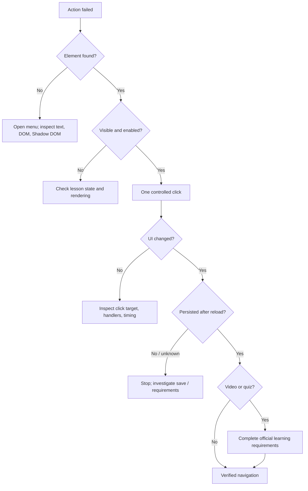
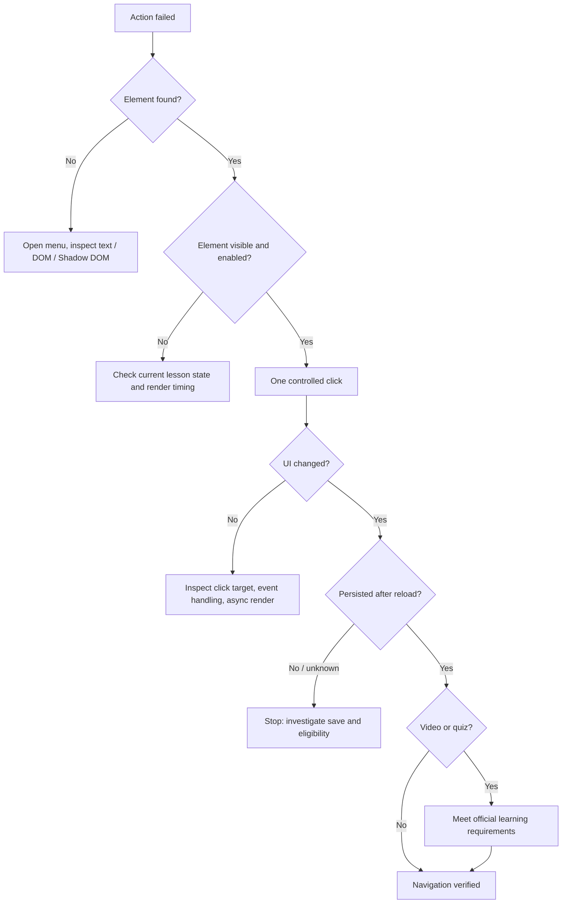

# Troubleshooting & Investigation Log

**Languages / Ngôn ngữ:** [English ↓](#english) · [Tiếng Việt ↓](#tiếng-việt)  
**Project overview / Tổng quan:** [README.md](../README.md)

**Evidence-first engineering case study / Case study phân tích dựa trên bằng chứng**

---

## English

**Project:** Browser UI Automation & Debugging Lab  
**Environment:** Firefox DevTools Console on an authenticated Jetking/Learnyst lesson page.  
**Method:** *Problem → Investigation → Root cause → Solution → Verification → Limitations*.

> **Evidence convention:** **[OBSERVED]** means captured in user-provided logs or confirmed interaction; **[INFERRED]** means an explanation consistent with evidence; **[UNVERIFIED]** means not demonstrated. A console message or one click does not establish server-side course completion.

### 1. Problem statement and success criteria

The course offers PDF, slides, and video lessons. The Settings menu has **Mark as complete / Mark as incomplete** and **Next lesson**. Repeating these UI operations motivated a small experiment in browser interaction—not a mechanism for bypassing learning requirements.

**Engineering objectives:** discover elements reliably, test a single click, distinguish complete/incomplete UI states, observe asynchronous navigation, understand video/player and CORS differences, and record the boundaries of what can be verified.

| Validation layer | Signal | Evidence status |
|---|---|---|
| DOM discovery | Target element and selector found | **Observed** |
| UI interaction | Menu text changed after a click | **Observed**, one user-confirmed trial |
| Bounded proof of concept | Three-iteration script reports two marks | **Observed** at script/UI level |
| State persistence | Status remains after refresh | **Not conclusively verified** |
| Video eligibility | Platform confirms real watch/completion conditions | **Not verified** |

### 2. Investigation timeline: 12 diagnostic checkpoints

| # | Symptom / observation | Competing hypothesis | Smallest experiment | Finding |
|---|---|---|---|---|
| **01** | Initial generic script said `Không tìm thấy nút hoàn thành` | Menu closed, lesson already complete, incorrect selector, Shadow DOM | Search button text and menu state | **[OBSERVED]** No initial match; not evidence of CORS failure. |
| **02** | `console.table()` was followed by `undefined` | The console command failed | Distinguish printed output from return value | **[OBSERVED]** `console.table()` normally returns `undefined`. |
| **03** | `SyntaxError: unexpected token: identifier` after entering `allow pasting` | The phrase is executable JavaScript | Inspect the entered statement | **[INFERRED]** That phrase was not valid JS in this console context. |
| **04** | Page appeared to use Web Components | Button may live in shadow tree or iframe | Scan document and open shadow roots | **[OBSERVED]** `shadowRoots: 5`, `frames: 0`, `matches: 2`. |
| **05** | Labels were `SPAN` elements | Click handler might belong to an ancestor | Inspect `parentElement.outerHTML` | **[OBSERVED]** Parent was `BUTTON role="menuitem"`. |
| **06** | One controlled click attempted | `.click()` may trigger UI handler | Click closest actionable ancestor once | **[OBSERVED]** User confirmed visible state changed. |
| **07** | Follow-up inspection said `Mark as complete NOT FOUND` | Selector broke or status changed | Inspect current menu items | **[OBSERVED]** Menu now showed `Mark as incomplete`. |
| **08** | Need to open the menu repeatably | Settings icon might have semantic attributes | Inspect ancestor HTML | **[OBSERVED]** `button.lp-icon[aria-label="Settings"]`; `aria-expanded`. |
| **09** | Three-iteration async test | UI timing may affect multi-step interaction | Bounded script, delays, state checks | **[OBSERVED]** Script reported two marks; not proof of persisted learning progress. |
| **10** | Repeated CORS warnings | Network warning caused element lookup failure | Examine warning and endpoint | **[INFERRED]** Related to cross-origin events endpoint; causality not established. |
| **11** | Navigated to a video | Player lifecycle may add conditions | Read render/load/progress logs | **[OBSERVED]** `start time 0`, `curprogress = 0`; loading is not viewing. |
| **12** | `lesson_completion`, `missing: (1)` log | Some criterion may be missing | Review sanitized message | **[UNVERIFIED]** The missing field/requirement is unknown. |

**Mindset:** New evidence should update the diagnosis. Once the menu says `Mark as incomplete`, do not keep treating a missing `Mark as complete` label as a selector failure.

### 3. Root cause analysis: why the first selector failed

**Symptom:**

```text
Không tìm thấy nút hoàn thành. Dừng.
Đã đánh dấu 0 bài trong lần chạy này.
```

**Established facts:** The action is inside an on-demand menu; its label depends on lesson status; menu items use `button.lp-menu-item`; the opener is `button.lp-icon[aria-label="Settings"]`; and the needed labels were found in the **main DOM** despite five other shadow roots existing on the page.

**Likely root cause [INFERRED, strongly supported]:** The initial script assumed the menu was visible and the active lesson would always offer `Mark as complete`. That assumption is false after a lesson has been marked, when the label becomes `Mark as incomplete`.

**What is *not* established:** Shadow DOM did not cause this specific lookup failure simply because five shadow roots existed. Likewise, the CORS warning does not demonstrate a failed completion request.

**Minimal corrective action:** Open the menu first; check **both** labels; target the actual `button`; inspect the result; reload if persistence matters.

### 4. Minimal read-only diagnostic tools

#### 4.1 Find candidate controls in the main DOM

```js
console.table(
  [...document.querySelectorAll('button, a, [role="button"], [role="menuitem"]')]
    .filter(el => /mark as complete|mark as incomplete|next lesson/i.test(el.textContent || ""))
    .map(el => ({
      tag: el.tagName,
      text: el.textContent.trim().slice(0, 100),
      role: el.getAttribute("role"),
      visible: el.getClientRects().length > 0
    }))
);
```

No match may mean the menu is closed or the content is not yet rendered; it does **not** establish that the action is absent from the application.

#### 4.2 Inspect open Shadow DOM (read-only)

```js
(() => {
  const matches = [];
  let shadowRoots = 0;
  let frames = 0;

  function scan(root, location = "document") {
    for (const el of root.querySelectorAll("*")) {
      if (el.shadowRoot) {
        shadowRoots++;
        scan(el.shadowRoot, `${location} > ${el.tagName}`);
      }
      if (el.tagName === "IFRAME") {
        frames++;
        try {
          if (el.contentDocument) scan(el.contentDocument, `${location} > iframe`);
        } catch {
          console.log("Cross-origin iframe inaccessible");
        }
      }
      const txt = (el.textContent || "").trim();
      if (el.children.length === 0 &&
          /^(Mark as complete|Mark as incomplete|Next lesson)$/i.test(txt)) {
        matches.push({ location, tag: el.tagName, text: txt });
      }
    }
  }

  scan(document);
  console.table(matches);
  console.log({ shadowRoots, frames, matches: matches.length });
})();
```

**Captured output:**

```text
SPAN | Next lesson
SPAN | Mark as complete
{ shadowRoots: 5, frames: 0, matches: 2 }
```

**Limit:** `el.shadowRoot` cannot inspect a **closed** shadow root. The zero-iframe count applies only to the inspected moment.

#### 4.3 Inspect actionable ancestors

```js
(() => {
  for (const label of ["Mark as complete", "Next lesson"]) {
    const el = [...document.querySelectorAll("span")]
      .find(node => node.textContent.trim() === label);
    if (!el) {
      console.log(label, "NOT FOUND");
      continue;
    }
    console.log("ACTION:", label);
    let parent = el;
    for (let i = 0; i < 4 && parent; i++, parent = parent.parentElement) {
      console.log(i, parent.outerHTML.slice(0, 400));
    }
  }
})();
```

**Observed HTML (shortened):**

```html
<button type="button" class="lp-menu-item" role="menuitem">
  <span>Next lesson</span>
</button>
<button type="button" class="lp-menu-item" role="menuitem">
  <span>Mark as incomplete</span>
</button>
<button class="lp-icon" aria-label="Settings"
        aria-haspopup="menu" aria-expanded="true">...</button>
```

The `span` carries the label; the surrounding `button` is the appropriate click target. The `aria-expanded` attribute describes the current menu state.

### 5. Solution proof of concept: single click and async workflow

#### 5.1 A one-click UI experiment

```js
(() => {
  const span = [...document.querySelectorAll("span")]
    .find(el => el.textContent.trim() === "Mark as complete");
  if (!span) return console.log("Mark as complete not found");

  const button = span.closest('button, [role="button"], [role="menuitem"], a')
    || span.parentElement;
  console.log("Click target:", button);
  button.click();
  console.log("Click sent; inspect UI and reload to check persistence.");
})();
```

**[OBSERVED]** The user confirmed a state change. Later menu inspection showed `Mark as incomplete`. This proves a UI-level response; it does **not** prove the server has accepted all course completion criteria.

#### 5.2 Historical, three-iteration asynchronous prototype

> This records the technical experiment previously run. **It is not a bulk-completion utility.** Only use such tests on lessons already legitimately completed, never to bypass watching, exams, or progress requirements.

```js
(async () => {
  const LIMIT = 3;
  const sleep = ms => new Promise(resolve => setTimeout(resolve, ms));
  const settings = () =>
    document.querySelector('button.lp-icon[aria-label="Settings"]');
  const menuItem = label =>
    [...document.querySelectorAll('button.lp-menu-item')]
      .find(el => el.textContent.trim() === label && el.getClientRects().length > 0);

  async function openMenu() {
    const button = settings();
    if (!button) throw new Error("Settings button not found");
    if (button.getAttribute("aria-expanded") !== "true") {
      button.click();
      await sleep(350);
    }
  }

  async function waitForUrlChange(oldUrl) {
    for (let i = 0; i < 30; i++) {
      if (location.href !== oldUrl) return true;
      await sleep(300);
    }
    return false;
  }

  let marked = 0;
  for (let i = 0; i < LIMIT; i++) {
    await openMenu();
    const complete = menuItem("Mark as complete");
    const already = menuItem("Mark as incomplete");

    if (complete) {
      // Only after meeting the lesson's actual learning requirements.
      complete.click();
      await sleep(600);
      await openMenu();
      if (!menuItem("Mark as incomplete")) {
        console.warn("UI completion state not confirmed. Stopping.");
        break;
      }
      marked++;
      console.log(`UI updated for lesson ${i + 1}`);
    } else if (already) {
      console.log(`Already marked: lesson ${i + 1}`);
    } else {
      console.warn("Unknown lesson state. Stopping.");
      break;
    }

    await openMenu();
    const next = menuItem("Next lesson");
    if (!next || next.disabled) break;
    const oldUrl = location.href;
    next.click();
    if (!(await waitForUrlChange(oldUrl))) {
      console.warn("URL transition not confirmed. Stopping.");
      break;
    }
    await sleep(1200);
  }
  console.log(`Reported UI marks: ${marked}`);
})();
```

**Captured summary:** The script reported marking lesson 2 and lesson 3, then `Đã đánh dấu thêm 2 bài` (2 additional marks).

**Why this is still a PoC:**

- `LIMIT` bounds loop iterations, not the number of lessons recognized by the platform.
- `sleep(350/600/1200)` is a timing guess, not a reliable synchronization primitive.
- A single-page application can change lessons without changing `location.href`.
- Full page reload can interrupt Console execution.
- `Mark as incomplete` confirms the *current UI*, not server persistence.
- A video lesson must **not** be automatically marked before its actual requirements are fulfilled.

### 6. CORS warning: signal or root cause?

**Sanitized warning:**

```text
Cross-Origin Request Warning:
The Same Origin Policy will disallow reading the remote resource at
https://events.learnyst.com/events?... soon.
Reason: when Access-Control-Allow-Headers is "*",
the Authorization header is not covered.
```

- **[OBSERVED]** The browser complained about an `Authorization` header in a cross-origin request.
- **[INFERRED]** This concerns CORS policy interaction at an event/telemetry endpoint.
- **[NOT ESTABLISHED]** No evidence links it to the failure to locate a DOM node or shows that lesson completion failed to save.
- **[ACTION]** Do not disable CORS or mishandle authentication headers; verify the actual failing request before assigning blame.

*Same-Origin Policy* limits reading cross-origin resources. *CORS* lets a server explicitly authorize selected cross-origin access. A forward-looking warning does not mean a request has already failed.

### 7. PDF/slides versus video: why lifecycle matters

**Sanitized observed log:**

```text
Video player render
Video player: componentDidMount
Initializing player
VideoPlayer: loading video with start time 0 curprogress = 0
Video player: loaded completed
onLoadedMetadata
[lesson-player] leaderboard award not attempted
{ lessonId: [redacted], templateType: "lesson_completion", missing: (1) [...] }
```

| Event / state | What it establishes | What it does **not** establish |
|---|---|---|
| `render`, `componentDidMount` | Player component initialized | Learner watched the video |
| `load started`, `loaded completed` | Player/media loading phase occurred | Video playback reached the end |
| `onLoadedMetadata` | Media metadata is available | Required watch percentage was reached |
| `start time 0`, `curprogress = 0` | Logged initial progress value | Every later/prolonged playback state remained zero |
| `lesson_completion ... missing: (1)` | A missing item was reported in that context | Its identity was watch time, quiz, or a specific requirement |
| `Mark as incomplete` in UI | Frontend displays marked status | All backend requirements were accepted |

**Video root-cause hypothesis [INFERRED]:** Playback/progress events may be part of the platform's video completion logic. The logs do **not** identify those rules or establish which backend operation, if any, failed.

**Read-only real-progress probe:**

```js
(() => {
  const result = [];
  function scan(root) {
    root.querySelectorAll("video").forEach(v => result.push({
      currentTime: v.currentTime,
      duration: v.duration,
      paused: v.paused,
      ended: v.ended,
      progress: Number.isFinite(v.duration) && v.duration > 0
        ? `${(v.currentTime / v.duration * 100).toFixed(1)}%`
        : "Unknown"
    }));
    root.querySelectorAll("*").forEach(el => {
      if (el.shadowRoot) scan(el.shadowRoot);
    });
  }
  scan(document);
  console.table(result);
  if (!result.length) console.log("No accessible HTML5 video element");
})();
```

An empty result does not establish that video is absent: it may be in a different context, a closed shadow root, or rendered via another mechanism. Do **not** forge playback events, seek state, completion requests, or API calls.

### 8. Debugging decision tree



### 9. Test matrix before any larger automation

| Scenario | Expected behavior | How to verify |
|---|---|---|
| Settings menu initially closed | Open it exactly once | `aria-expanded` becomes `true` |
| Reviewed but unmarked lesson | `Mark as complete` is available | Inspect menu; at most one controlled click |
| Already marked lesson | `Mark as incomplete`; do not click again | Inspect menu label |
| Menu label changes after click | Do not duplicate an action | Observe subsequent UI state |
| SPA navigation | Actual lesson changes | Verify heading/lesson identifier, not only URL |
| Slow network | Do not race ongoing updates | Condition-based waits with timeouts |
| Full page reload | Script must not assume persistent context | Stop and resume only under user control |
| PDF / slide | Reflect actual official completion | Reload and check displayed progress |
| Video not yet watched | Never auto-mark or skip | Watch and verify real player progress |
| Quiz / test | Leave assessment to the learner | Complete assessment normally |
| CORS warning appears | Avoid unsupported causality claims | Identify request and observed effect |

### 10. Logging, privacy, and GitHub evidence hygiene

An appropriately **sanitized** engineering log may look like:

```text
2026-11-10 [OBSERVED] Initial selector returned 0 matches.
2026-11-10 [OBSERVED] Found 2 action labels in main DOM; 5 open shadow roots.
2026-11-10 [OBSERVED] Action parent was button.lp-menu-item.
2026-11-10 [OBSERVED] UI changed to "Mark as incomplete" after controlled click.
2026-11-10 [UNVERIFIED] Persistence after reload not measured.
```

**Never publish:** tokenized player URLs (`tk=...`), cookies, bearer headers, session values, raw HAR exports, sensitive account details, or private screenshots. The original player logs included URL query parameters that **must not** be copied to a public repo even if the tokens later expire.

**Reusable incident template:**

```markdown
#### Incident: [short title]
- **Problem:** What failed and under which conditions?
- **Observed:** Sanitized log or screenshot.
- **Hypotheses:** H1 / H2 / H3 and confidence.
- **Experiment:** Smallest safe test that discriminates hypotheses.
- **Result:** What changed, and what did not?
- **Root cause:** Confirmed, probable, or unknown.
- **Solution:** Minimal corrective change.
- **Verification:** UI, persistence, edge cases.
- **Limitations:** What is still unproven?
```

### 11. Lessons learned

1. **Debug by layers:** Element discovery → event target → async rendering → UI state → server persistence → course rules.
2. **Do not confuse signals:** Console `undefined`, CORS warning, and video `loaded completed` describe different phenomena.
3. **Selectors need state context:** Prefer semantic controls, visibility checks, and current labels.
4. **Async correctness matters:** Waiting for the actual state is stronger than sleeping for a guessed duration.
5. **Document negative results:** Clear evidence boundaries matter more than a polished demo.
6. **Be responsible:** Automation may assist completed learning workflows, not falsify learning activity.

### 12. Final assessment

**Problem:** Initial script could not find the completion control.  
**Investigation:** Menu status, HTML ancestors, DOM/Shadow DOM, Console, and video logs.  
**Likely root cause:** Invalid assumptions about whether the Settings menu was open and whether the lesson should show `Mark as complete` or `Mark as incomplete`.  
**Observed fix:** Select the actionable `button.lp-menu-item`, open the menu first, and validate the resulting UI; one click was confirmed and a bounded test reported two marks.  
**Remaining unknowns:** Persistence after refresh, exact video completion requirements, and behavior under all SPA/reload states.

> Good debugging asks not only *“Does it run?”* but *“What evidence would justify claiming it is correct?”*

---

## Tiếng Việt

**Project:** Browser UI Automation & Debugging Lab  
**Case study:** Jetking learning portal / Learnyst-based lesson UI  
**Environment:** Firefox DevTools Console, giao diện học trực tuyến, JavaScript chạy trên trang đã đăng nhập.  
**Phương pháp:** *Problem → Investigation → Root Cause → Solution → Verification → Limitations*.

> **Cách đọc tài liệu:** Mỗi kết luận được gắn mức độ **[OBSERVED]** (có log/ảnh xác nhận), **[INFERRED]** (suy luận từ dữ liệu) hoặc **[UNVERIFIED]** (chưa đủ kiểm chứng). Không giả định rằng một dòng Console hoặc một click chứng minh hoàn thành bài học phía server.

### 1. Problem statement & success criteria

#### Bài toán

Một khóa học có nhiều bài thuộc các loại PDF, Slides, Video. Giao diện hỗ trợ menu **Settings → Mark as complete / Mark as incomplete** và **Next lesson**, nhưng thao tác thủ công lặp đi lặp lại.

#### Mục tiêu kỹ thuật

1. Xác định đúng nút từ DOM thay vì dựa vào tọa độ màn hình.
2. Thực hiện **một** click có kiểm soát trên bài đã học.
3. Phân biệt trạng thái đã/ chưa hoàn thành của UI.
4. Điều hướng sang bài kế và kiểm tra ứng dụng cập nhật bất đồng bộ.
5. Điều tra các trường hợp khác biệt như video player và CORS warning.
6. Ghi nhận giới hạn; **không** giả lập lượt xem video, không thay đổi backend trái phép.

#### Tiêu chí thành công phân tầng

| Cấp độ | Dấu hiệu | Đã kiểm chứng? |
|---|---|---|
| **DOM discovery** | Tìm đúng element và selector | **Có** |
| **UI interaction** | Click khiến menu đổi nhãn | **Có**, 1 bài được người dùng xác nhận |
| **Bounded automation** | Log thử nghiệm giới hạn 3 bài, 2 bài được đánh dấu | **Có ở cấp UI/script** |
| **Persistence** | Refresh xong trạng thái vẫn giữ | **Chưa có evidence rõ ràng** |
| **Video eligibility** | Nền tảng công nhận đủ thời lượng/điều kiện xem | **Chưa xác nhận** |

### 2. Investigation timeline — từng lần thử và cách suy luận

| # | Problem / Observation | Hypotheses | Experiment | Kết quả / kết luận |
|---|---|---|---|---|
| **01** | Script tổng quát báo `Không tìm thấy nút hoàn thành` | Menu đóng; bài đã xong; selector quá rộng/sai; Shadow DOM | Tìm text các nút và xem menu | **[OBSERVED]** Chưa tìm được ở lần đầu; không thể kết luận do CORS |
| **02** | `console.table()` in `undefined` | Có thể tưởng lỗi Console | Phân biệt log hiển thị và return value | **[OBSERVED]** `console.table()` thường trả `undefined` — bình thường |
| **03** | Có lỗi `SyntaxError: unexpected token: identifier` sau khi gõ `allow pasting` | Chuỗi không phải lệnh JS | Đọc lại dòng vừa nhập | **[INFERRED]** `allow pasting` không phải câu lệnh JS hợp lệ trong ngữ cảnh đó; không liên quan nút học |
| **04** | Giao diện có Web Components | Element nằm ở Shadow DOM/iframe? | Quét cây DOM + shadow roots | **[OBSERVED]** `shadowRoots: 5`, `frames: 0`, `matches: 2` |
| **05** | Tìm được nhãn `Next lesson` và `Mark as complete` | Text nằm trong `SPAN` nhưng event handler ở cha | Đọc `parentElement.outerHTML` | **[OBSERVED]** Element cha là `BUTTON` với `role="menuitem"` |
| **06** | Click một nút đánh dấu | Có thể click được qua DOM API | Gọi `closest(...).click()` trên 1 bài | **[OBSERVED]** Người dùng xác nhận trạng thái đổi thành công |
| **07** | Chạy lại script và báo `Mark as complete NOT FOUND` | Selector hỏng hay bài đã complete? | Đọc menu HTML hiện tại | **[OBSERVED]** Có `Mark as incomplete`: trạng thái UI đã đổi, không phải mất nút ngẫu nhiên |
| **08** | Cần mở menu tự động | Settings icon có thuộc tính nhận diện? | Inspect HTML ancestor | **[OBSERVED]** `button.lp-icon[aria-label="Settings"]`, `aria-expanded` |
| **09** | Thử 3 bài với async flow | Click và điều hướng có theo kịp UI không? | Script giới hạn 3, có delay và kiểm tra state | **[OBSERVED]** Log `Đã đánh dấu thêm 2 bài`; không suy ra đã học xong/video đạt điều kiện |
| **10** | Console nhiều cảnh báo CORS | Có phải nguyên nhân script lỗi? | Đọc endpoint và nội dung cảnh báo | **[INFERRED]** Cảnh báo từ `events.learnyst.com`, không chứng minh request ghi completion thất bại |
| **11** | Gặp bài Video | Video player có vòng đời sự kiện khác? | Phân tích log `render`, `componentDidMount`, `loaded completed`, progress | **[OBSERVED]** Player tải từ `start time 0`, `curprogress = 0`; load xong chỉ là load xong |
| **12** | Log `lesson_completion`, `missing: (1)` | Thiếu tiêu chí hoàn thành/trao thưởng? | Chỉ đọc log (không thấy `missing` chứa gì) | **[UNVERIFIED]** Chưa thể xác định chính xác tiêu chí thiếu |

**Mindset:** Khi giả thuyết thay đổi vì một bằng chứng mới (`Mark as incomplete`), **cập nhật chẩn đoán**, đừng cố sửa selector theo giả thuyết ban đầu.

### 3. Root cause analysis: vì sao script đầu tiên không thấy nút?

#### Symptom

```text
Không tìm thấy nút hoàn thành. Dừng.
Đã đánh dấu 0 bài trong lần chạy này.
```

#### Điều đã biết

- **[OBSERVED]** Nút hoàn thành nằm trong một menu, không luôn hiển thị.
- **[OBSERVED]** Khi bài đã được đánh dấu, nhãn đổi từ `Mark as complete` thành `Mark as incomplete`.
- **[OBSERVED]** Nút `Next lesson` và nút complete/incomplete thuộc các `button.lp-menu-item`.
- **[OBSERVED]** Menu được mở bằng nút `button.lp-icon[aria-label="Settings"]`.
- **[OBSERVED]** Có Shadow Roots trên trang nhưng **hai nhãn cần tìm được thấy ở DOM chính**.

#### Kết luận nguyên nhân

**[INFERRED, có hỗ trợ mạnh]** Script ban đầu giả định sai về **trạng thái giao diện**: chỉ tìm chuỗi `Mark as complete` mà không đảm bảo menu đang mở hay bài chưa complete. Điều này giải thích hợp lý việc `NOT FOUND` sau khi vừa đánh dấu xong.

**Không kết luận** Shadow DOM là root cause: số lượng Shadow Roots không chứng minh hai nút nằm trong Shadow DOM. **Không kết luận** CORS là root cause vì không có bằng chứng request completion bị chặn.

#### Corrective action

1. Mở menu nếu chưa mở.
2. Kiểm tra cả `Mark as complete` **và** `Mark as incomplete`.
3. Chọn `button` có đúng nhãn, không click `span` ngẫu nhiên.
4. Sau click, đọc lại trạng thái và (khi phù hợp) refresh để kiểm tra persistence.

### 4. Công cụ debug nhỏ nhất trước khi tự động hóa

#### 4.1. Tìm nút trong DOM chính — read only

```js
console.table(
  [...document.querySelectorAll('button, a, [role="button"], [role="menuitem"]')]
    .filter(el => /mark as complete|mark as incomplete|next lesson/i.test(el.textContent || ""))
    .map(el => ({
      tag: el.tagName,
      text: el.textContent.trim().slice(0, 100),
      role: el.getAttribute("role"),
      visible: el.getClientRects().length > 0
    }))
);
```

**Đọc kết quả:** Không thấy nút có thể do menu đóng hoặc DOM chưa render, không đồng nghĩa bài không có hành động này.

#### 4.2. Quét Shadow DOM — read only

```js
(() => {
  const matches = [];
  let shadowRoots = 0;
  let frames = 0;

  function scan(root, location = "document") {
    for (const el of root.querySelectorAll("*")) {
      if (el.shadowRoot) {
        shadowRoots++;
        scan(el.shadowRoot, `${location} > ${el.tagName}`);
      }
      if (el.tagName === "IFRAME") {
        frames++;
        try {
          if (el.contentDocument) scan(el.contentDocument, `${location} > iframe`);
        } catch {
          console.log("Cross-origin iframe inaccessible");
        }
      }
      const txt = (el.textContent || "").trim();
      if (el.children.length === 0 &&
          /^(Mark as complete|Mark as incomplete|Next lesson)$/i.test(txt)) {
        matches.push({ location, tag: el.tagName, text: txt });
      }
    }
  }

  scan(document);
  console.table(matches);
  console.log({ shadowRoots, frames, matches: matches.length });
})();
```

**Kết quả quan sát thực tế tại thời điểm quét:**

```text
SPAN | Next lesson
SPAN | Mark as complete
{ shadowRoots: 5, frames: 0, matches: 2 }
```

**Giới hạn:** `element.shadowRoot` chỉ đọc được shadow root kiểu `open`; iframe khác origin không truy cập được DOM trực tiếp. `frames: 0` là kết quả **tại lần quét đó**, không khẳng định trang không bao giờ dùng iframe.

#### 4.3. Inspect ancestor và chọn element click

```js
(() => {
  for (const label of ["Mark as complete", "Next lesson"]) {
    const el = [...document.querySelectorAll("span")]
      .find(node => node.textContent.trim() === label);
    if (!el) return console.log(label, "NOT FOUND");

    console.log("ACTION:", label);
    let parent = el;
    for (let i = 0; i < 4 && parent; i++, parent = parent.parentElement) {
      console.log(i, parent.outerHTML.slice(0, 400));
    }
  }
})();
```

**HTML đã quan sát (rút gọn):**

```html
<button type="button" class="lp-menu-item" role="menuitem">
  <span>Next lesson</span>
</button>
<button type="button" class="lp-menu-item" role="menuitem">
  <span>Mark as incomplete</span>
</button>
<button class="lp-icon" aria-label="Settings"
        aria-haspopup="menu" aria-expanded="true">...</button>
```

**Suy luận:** `span` là phần hiển thị nhãn; `button` cha là target hợp lý hơn để gọi `.click()`. `aria-expanded` biểu diễn menu đang mở/đóng.

### 5. Solution PoC — từ một click sang async workflow

#### 5.1. Một click được xác nhận ở cấp UI

```js
(() => {
  const span = [...document.querySelectorAll("span")]
    .find(el => el.textContent.trim() === "Mark as complete");
  if (!span) return console.log("Không tìm thấy Mark as complete");

  const button = span.closest('button, [role="button"], [role="menuitem"], a')
    || span.parentElement;
  console.log("Click target:", button);
  button.click();
  console.log("Đã gửi click; cần kiểm tra UI và trạng thái sau refresh.");
})();
```

**[OBSERVED]** Người dùng xác nhận thao tác thành công. Ở lần xem menu tiếp theo, xuất hiện `Mark as incomplete`.

#### 5.2. Thử nghiệm giới hạn ba bài (historical PoC)

Đây là mô tả kỹ thuật của script đã thử trong cuộc điều tra — **không phải công cụ dùng đại trà**. Chỉ chạy trên chuỗi bài đã thực sự học và được phép tự đánh dấu; **không** dùng nó để vượt điều kiện xem video/quiz.

```js
(async () => {
  const LIMIT = 3; // Giới hạn thử nghiệm
  const sleep = ms => new Promise(resolve => setTimeout(resolve, ms));
  const settings = () =>
    document.querySelector('button.lp-icon[aria-label="Settings"]');
  const menuItem = label =>
    [...document.querySelectorAll('button.lp-menu-item')]
      .find(el => el.textContent.trim() === label && el.getClientRects().length > 0);

  async function openMenu() {
    const button = settings();
    if (!button) throw new Error("Không tìm thấy Settings");
    if (button.getAttribute("aria-expanded") !== "true") {
      button.click();
      await sleep(350);
    }
  }

  async function waitForUrlChange(oldUrl) {
    for (let i = 0; i < 30; i++) {
      if (location.href !== oldUrl) return true;
      await sleep(300);
    }
    return false;
  }

  let marked = 0;
  for (let i = 0; i < LIMIT; i++) {
    await openMenu();
    const complete = menuItem("Mark as complete");
    const already = menuItem("Mark as incomplete");

    if (complete) {
      // Chỉ hợp lệ khi bài hiện tại đã thực sự học/hoàn thành yêu cầu.
      complete.click();
      await sleep(600);
      await openMenu();
      if (!menuItem("Mark as incomplete")) {
        console.warn("Chưa xác nhận trạng thái UI. Dừng.");
        break;
      }
      marked++;
      console.log(`UI updated for lesson ${i + 1}`);
    } else if (already) {
      console.log(`Already marked: lesson ${i + 1}`);
    } else {
      console.warn("Không xác định trạng thái. Dừng.");
      break;
    }

    await openMenu();
    const next = menuItem("Next lesson");
    if (!next || next.disabled) break;
    const oldUrl = location.href;
    next.click();
    if (!(await waitForUrlChange(oldUrl))) {
      console.warn("Không xác nhận được chuyển bài qua URL. Dừng.");
      break;
    }
    await sleep(1200);
  }
  console.log(`Reported UI marks: ${marked}`);
})();
```

**Log thực tế:** `Đã hoàn thành bài 2`, `Đã hoàn thành bài 3`, `Kết thúc. Đã đánh dấu thêm 2 bài.`

**Giải thích giới hạn của code:**

- `LIMIT = 3` là giới hạn số lần lặp, **không phải** số lượng bài được server công nhận.
- `sleep(350/600/1200)` là thời gian chờ phỏng đoán, không phải điều kiện đồng bộ đáng tin.
- `waitForUrlChange()` có thể sai nếu ứng dụng thay bài bằng SPA state mà không đổi URL; cũng không chứng minh nội dung thực sự đã render xong.
- Nếu chuyển bài gây full reload, Console script có thể mất context và dừng giữa chừng.
- Việc kiểm tra `Mark as incomplete` chỉ xác nhận trạng thái **UI ở thời điểm đó**, không xác nhận backend đã persist sau refresh.
- **Bài video:** không được tự động đánh dấu nếu chưa hoàn tất yêu cầu xem thực tế.

### 6. CORS Warning — cảnh báo nào là nguyên nhân thật?

#### Log quan sát (đã ẩn thông tin không cần thiết)

```text
Cross-Origin Request Warning:
The Same Origin Policy will disallow reading the remote resource at
https://events.learnyst.com/events?... soon.
Reason: when Access-Control-Allow-Headers is "*",
the Authorization header is not covered.
```

#### Phân tích

- **[OBSERVED]** Trình duyệt cảnh báo về việc sử dụng `Authorization` header trong cross-origin request.
- **[INFERRED]** Đây là vấn đề phối hợp chính sách CORS giữa frontend và server ở endpoint event/telemetry.
- **[NOT ESTABLISHED]** Không có bằng chứng warning này là nguyên nhân script không tìm thấy DOM element hay nút hoàn thành không lưu.
- **[ACTION]** Không vô hiệu hóa CORS, không sửa/đánh cắp header, không dựa vào warning riêng lẻ để kết luận request lỗi.

**Khái niệm:** *Same-Origin Policy* hạn chế một trang đọc dữ liệu từ origin khác. *CORS* cho server khai báo các điều kiện truy cập cross-origin. Cảnh báo "will disallow ... soon" không đồng nghĩa chắc chắn request hiện tại đã thất bại.

### 7. PDF/Slides khác Video ở đâu?

#### Console đã cung cấp (đã tóm tắt, bỏ đường dẫn chứa token)

```text
Video player render
Video player: componentDidMount
Initializing player
VideoPlayer: loading video with start time 0 curprogress = 0
Video player: loaded completed
onLoadedMetadata
[lesson-player] leaderboard award not attempted
{ lessonId: [redacted], templateType: "lesson_completion", missing: (1) [...] }
```

#### Phân biệt các loại event

| Event / state | Nghĩa có thể khẳng định | **Không** có nghĩa là |
|---|---|---|
| `render`, `componentDidMount` | Component player được tạo/khởi tạo | User đã xem video |
| `load started`, `loaded completed` | Tài nguyên/player tải xong | Video đã phát xong |
| `onLoadedMetadata` | Metadata phương tiện đã có | Đã đủ % yêu cầu |
| `start time 0`, `curprogress = 0` | Tại thời điểm log, progress được ghi là 0 | Toàn bộ lịch sử xem luôn là 0 |
| `lesson_completion ... missing: (1)` | Có log báo **một mục thiếu** trong ngữ cảnh đó | Biết chắc mục thiếu là thời lượng xem/quiz |
| UI đổi sang `Mark as incomplete` | UI đang hiển thị đã đánh dấu | Backend đã xác nhận mọi điều kiện học |

#### Root cause hypothesis cho Video

**[INFERRED]** Video có thể được theo dõi bằng các sự kiện playback/progress và điều kiện hoàn thành riêng, thay vì chỉ qua nút đánh dấu. Tuy nhiên log chưa đủ xác nhận điều kiện cụ thể hoặc việc đánh dấu có thất bại phía server hay không.

#### Experiment tiếp theo: quan sát tiến độ **thật**, chỉ đọc

```js
(() => {
  const result = [];
  function scan(root) {
    root.querySelectorAll("video").forEach(v => result.push({
      currentTime: v.currentTime,
      duration: v.duration,
      paused: v.paused,
      ended: v.ended,
      progress: Number.isFinite(v.duration) && v.duration > 0
        ? `${(v.currentTime / v.duration * 100).toFixed(1)}%`
        : "Unknown"
    }));
    root.querySelectorAll("*").forEach(el => {
      if (el.shadowRoot) scan(el.shadowRoot);
    });
  }
  scan(document);
  console.table(result);
  if (!result.length) console.log("No accessible HTML5 video element");
})();
```

**Nếu không tìm thấy video:** chưa đủ cơ sở suy luận video không phát; player có thể dùng công nghệ khác, shadow root `closed` hoặc context khác. Không nên can thiệp vào thời gian phát, seek, video event hay các endpoint để giả mạo xem hết.

### 8. Debugging decision tree



### 9. Test matrix trước khi nâng cấp automation

| Test case | Expected behavior | Cách kiểm chứng |
|---|---|---|
| Settings menu đóng | Tìm đúng nút và mở menu một lần | `aria-expanded` trở thành `true` |
| Bài chưa complete nhưng đã học | Có `Mark as complete` | Kiểm tra menu, click 1 lần |
| Bài đã complete | Có `Mark as incomplete`, không click lại | Kiểm tra nhãn |
| Menu đổi sau click | Không bị click trùng | Đợi UI state và kiểm tra nhãn mới |
| SPA điều hướng | Bài hiện tại thực sự thay đổi | So sánh heading/lesson identifier, không chỉ URL |
| Mạng chậm | Script không vượt trạng thái đang tải | Condition wait có timeout, không chỉ sleep |
| Full page reload | Script không giả định context còn sống | Chạy lại thủ công hoặc dùng cơ chế opt-in được kiểm soát |
| PDF/Slides | Tôn trọng trạng thái completion chính thức | Reload và kiểm tra tiến độ |
| Video chưa xem xong | Không auto-mark/auto-skip | Theo dõi tiến độ xem thực tế |
| Quiz/Test | Không tự hoàn thành | Người dùng tự hoàn thành đánh giá |
| CORS warning | Không đổ lỗi chỉ vì thấy warning | Xác minh lỗi đúng request/hành vi liên quan |

### 10. Logging, privacy và cách lưu evidence trên GitHub

Nên lưu **log sạch** ở mức quan sát, ví dụ:

```text
2026-11-10 [OBSERVED] Initial selector returned 0 matches.
2026-11-10 [OBSERVED] Main DOM has 2 action text matches; 5 open shadow roots.
2026-11-10 [OBSERVED] Button parent selector is .lp-menu-item.
2026-11-10 [OBSERVED] UI changed to 'Mark as incomplete' after manual trial.
2026-11-10 [UNVERIFIED] Persistence after reload not yet measured.
```

**Không commit**: request URLs chứa `tk=...`, cookies, bearer tokens, session identifiers, raw HAR, user IDs, ảnh lộ thông tin tài khoản hoặc những thông tin đăng nhập tương đương. Trong log video gốc có URL player với tham số `tk`; **không copy link này vào repo**, kể cả nếu token đã hết hạn.

#### Debugging note template (tái sử dụng)

```markdown
#### Incident: [Short title]
- **Problem:** What failed, under what conditions?
- **Observed:** Exact sanitized log or screenshot evidence.
- **Hypotheses:** H1 / H2 / H3, with confidence levels.
- **Experiment:** Smallest safe change that distinguishes hypotheses.
- **Result:** What happened? What did NOT happen?
- **Root cause:** Confirmed / likely / unknown.
- **Solution:** Minimal corrective change.
- **Verification:** UI, persistence, edge cases.
- **Limitations:** What remains unproven?
```

### 11. Lessons learned

1. **Một lỗi có thể ở nhiều lớp:** DOM discovery, event targeting, timing, UI state, network persistence hoặc quy tắc bài học — kiểm tra từng lớp.
2. **Đừng nhầm tín hiệu:** `undefined` của Console, CORS warning, video `loaded completed` và status học tập là các hiện tượng khác nhau.
3. **Selector chỉ là điểm bắt đầu:** Kết hợp semantic HTML, visibility và current state.
4. **Async là phần của logic đúng:** Chờ trạng thái thực thay cho sleep cứng nếu có thể.
5. **Báo cáo trung thực hơn demo đẹp:** Gắn nhãn Observed / Inferred / Unverified, ghi cả thử nghiệm thất bại.
6. **Responsible automation:** Tối ưu thao tác sau khi học, không làm sai lệch tiến độ học tập.

### 12. Kết luận

**Problem:** Script ban đầu không tìm thấy nút.  
**Investigation:** Kiểm tra DOM, menu state, Shadow DOM, HTML ancestor và Console.  
**Likely root cause:** Giả định sai về trạng thái/khả năng hiển thị của menu và nhãn complete/incomplete.  
**Validated solution:** Chọn đúng `button.lp-menu-item`, mở Settings trước, xác minh UI sau click; một click thử nghiệm thành công, script thử 3 bài ghi nhận 2 lần đánh dấu.  
**Remaining limitations:** Chưa xác nhận persistence đầy đủ, không xác định điều kiện video completion, chưa kiểm thử đủ các trạng thái SPA/refresh.  

> Một người debug tốt không chỉ biết *lệnh nào chạy*, mà còn biết *bằng chứng nào đủ để tuyên bố nó chạy đúng*.
